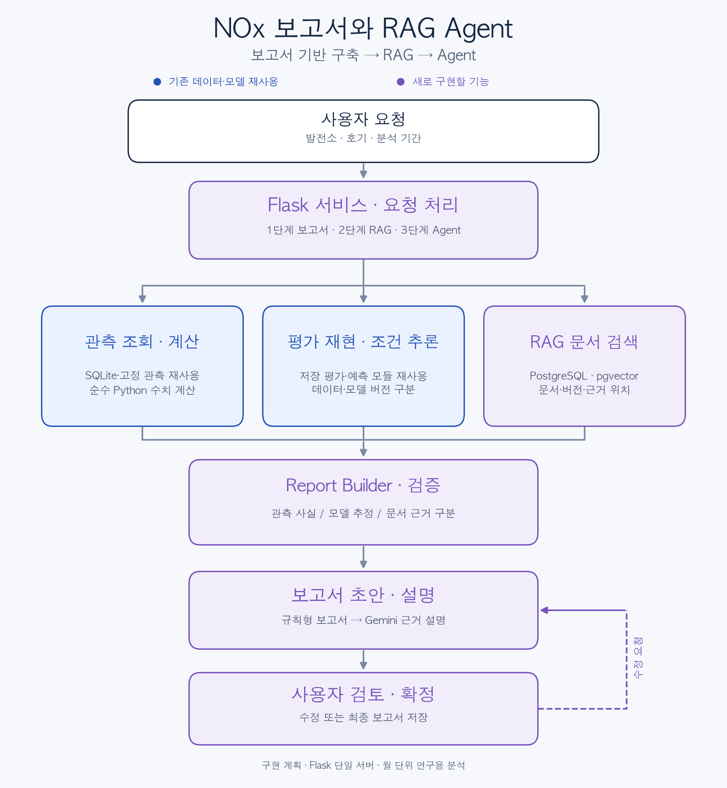

# NOx 보고서 자동화와 RAG Agent 구현 계획

작성일 2026년 10월 13일

월별 NOx 관측·저장된 모델 예측·문서 근거를 연결해 분석 및 점검 보고서 초안을 만드는 시스템을 구현합니다. 먼저 LLM 없이 재현되는 보고서를 구축하고, RAG로 근거를 추가한 뒤 Agent가 요청에 맞는 도구를 선택하도록 확장합니다. 초기 서버는 기존 Flask를 사용합니다.

이 문서의 신규 기능, 모듈, API, 일정, 성능 기준은 구현 계획입니다. 기존 코드에서 확인한 기능과 앞으로 구현할 기능을 구분합니다.

2026-10-14 갱신: 문서 10개·원문 근거 질문 50개·BM25/실제 E5/Hybrid 검색·3개 API와 첫 평가를 구현했습니다. 로컬 정확 코사인과 BM25를 사용하며 pgvector·재순위 모델·RAG 답변 생성·Agent는 후속 단계입니다. [검색 구현과 측정 결과](RAG_RETRIEVAL.md)에 설계 대비 변경점과 남은 품질 문제를 기록했습니다.

2026-10-14 후속 갱신: [근거 보고서·Agent 구현](COPILOT_WORKFLOW_20261014.md)을 완료했습니다. 한영/범위 검색 보완·수치/문서 참조·Gemini 설명 계약·LangGraph/SQLite·백그라운드·검토/개정/재개·복구를 추가했고 전체 419개 테스트와 실제 HTTP를 확인했습니다. 기본 도구 선택은 규칙 기반이며 Gemini 선택·설명은 코드/모의 검증까지입니다. 실제 Gemini 호출·독립 의미 검토·새 조건/호기·운영 배포는 남아 있습니다.

## 목표와 첫 사용 사례

첫 요청은 “영동 1호기의 2025년 10월 관측 NOx와 저장된 평가 예측을 비교하고, 데이터 품질과 관련 기술자료를 참고해 점검 보고서 초안을 작성해 주세요”로 고정합니다.

보고서는 관측 사실, 모델 추정, 문서에 근거한 일반 확인 사항, 미확인 사항을 구분합니다. 원인 확인에 필요한 기관 자료가 없으면 원인을 확정하지 않습니다. 모델 오차 개선과 RAG·Agent 개선은 별도로 평가합니다.

| 단계 | 핵심 결과물 | 통과 후 다음 단계 |
| --- | --- | --- |
| 보고서 기반 구축 | 고정된 평가 기록으로 만든 report_data.json과 HTML 보고서 | 수치·출처·품질 경고 재현 확인 |
| RAG 추가 | 문서 검색, 근거 표시, 검색 방식 비교 결과 | 검색 품질과 적용 범위 확인 |
| Agent 연결 | 요청별 도구 선택, 실행 기록, 검토·재개 | 실제 호출과 실패 복구 시나리오 확인 |

## 현재 자산과 구현 경계

| 기존 자산 | 재사용 방식 | 필요한 보완 |
| --- | --- | --- |
| nox/predict.py의 Predictor.predict | 새로운 조건 추론 도구의 내부 서비스 | 보고서용 결과 계약과 모델 선택 제한 |
| nox/features.py | 동일한 특징·전처리 재사용 | 별도 특징 계산 코드를 만들지 않음 |
| nox/history.py의 HistoryStore | 출처·개정·입수 시점이 있는 관측 조회 | 발전소·호기·기간별 결과를 제한해 반환 |
| nox/quality.py | 검토 이유와 품질 상태 | 보고서에 상태·한계를 유지 |
| nox/app.py | 기존 Flask에 Blueprint 추가 | 보고서·검색·Agent 기능을 선택적으로 등록 |
| nox/llm.py | 타임아웃·형식 오류·기본 설명 처리 원칙 | RAG용 응답 계약과 도구 호출용 클라이언트 분리 |
| 기간별 검증 C 모델과 저장 예측 | 첫 보고서의 평가 재현 | 고정 관측·예측·모델 파일의 해시 연결 |

기본 /api/predict 동작과 저장 모델은 별도로 유지합니다. RMSE 22.28ppm 후보는 기존 기본 API 모델과 동일한 배포 패키지가 아니므로 이 작업에서 자동 교체하지 않습니다. 보고서 재현에는 재학습이 필요하지 않습니다.

첫 구현에서 다루는 범위는 월 단위 연구 분석입니다. 실시간 이상 탐지, 설비 제어, 법적 배출기준 판정, 월 총배출량 kg 환산, 실제 미래 예측은 별도 검증 후 확장할 항목입니다.

## 분석 모드와 시간 기준

| 모드 | 의미 | 첫 버전 지원 |
| --- | --- | --- |
| evaluation_replay | 저장된 시간 순서 평가의 관측·예측을 재현 | 지원 |
| conditional_estimate | 지정한 월별 운전 조건과 이전 이력으로 새 추론 | 1단계 후반에 지원 |
| forward_forecast | 특정 시점에 입수 가능했던 입력으로 미래 예측 | 지원하지 않음 |

analysis_month는 분석 대상 월, report_generated_at은 보고서 생성 시각입니다. trained_through는 학습 자료의 종료 월, model_created_at은 실제 모델 파일 생성 시각입니다. 서로 바꿔 쓰지 않습니다.

기존 as_of는 관측 이력을 제한하지만 요청에 들어온 발전량·연료의 당시 입수 가능성을 검증하지 않습니다. 모델 가중치의 과거 버전도 복원하지 않습니다. 공개 시점이 미확인인 입력에는 availability_status를 unknown 또는 assumed로 기록합니다.

과거 월을 현재 분석하는 보고서는 당시 배포된 서비스의 예측 기록으로 소개하지 않습니다. 미래 예측을 추가할 때는 입력별 공개·입수 시각, 월초에 사용할 대체 입력, 해당 시점 모델 버전부터 별도로 검증합니다.

## 첫 사례와 원본 보존

2026년 10월 13일에 확인한 영동 1호기 2025년 10월 사례에는 관측값과 저장된 XGBoost·LightGBM·앙상블 평가 예측이 있습니다. 저장 평가 기록의 입력 검증은 통과했고 직전 3개월 관측이 있습니다. C 모델의 고정 history.csv와 평가 CSV의 타깃도 일치합니다. 품질 상태는 review_required이며, 기관의 측정 유효성 확인은 남아 있습니다.

C 모델은 2023년 1월~2024년 12월 학습, 2025년 1~6월 선정, 2025년 7~12월 평가 구성입니다. 모델 파일은 2026년 10월 1일에 생성되었습니다.

아래 경로는 NOx_corrected를 기준으로 한 기존 로컬 자산입니다. 원천 자료와 모델은 공개 Git에 포함하지 않습니다.

| 파일 | 역할 |
| --- | --- |
| reports/temporal_validation_20261001/models/unit_actual/C/history.csv | 동일 평가 자료의 고정 관측·조건·품질 상태 |
| 같은 디렉터리의 test_predictions.csv | 모델별 저장 평가 예측 |
| 같은 디렉터리의 metadata.json | 타깃·기간·모델 가중치·생성 시각 |
| 같은 디렉터리의 selection_lock.json | 평가 전 고정한 구성 확인 |
| 같은 디렉터리의 preprocessor.json, xgb_model.json, lgb_model.txt | 추론·전처리 재현 |
| reports/temporal_validation_20261001/unit_actual_outer_predictions.csv | 기간별 통합 평가와 입력 검증 기록 |

첫 단계에서는 C 모델 디렉터리를 하나의 평가 묶음으로 등록합니다. 통합 CSV를 함께 사용할 때는 plant·unit·month·fold로 유일하게 대응하고 관측값을 대조합니다. 현재 SQLite의 수정된 관측을 고정 평가 관측에 조용히 덮어쓰지 않습니다.

초기 등록 시 필요한 모든 파일의 SHA-256을 manifest에 기록합니다. 등록 이후 해시가 달라지면 새 버전을 등록하거나 생성 요청을 중단합니다. 최초 해시 등록은 파일 변경 검출을 위한 기준이며 원자료 측정의 유효성을 증명하지는 않습니다.

## 공통 데이터 계약

보고서 핵심 데이터는 엄격한 스키마로 검증합니다. Pydantic을 도입하면 형식 검증과 의미 검증을 구분하고, 요청에는 strict 모드와 알 수 없는 필드 거부 정책을 적용합니다.

| 필드 | 내용 |
| --- | --- |
| schema_version | 보고서 데이터 구조 버전 |
| analysis_mode, case_key | 분석 모드와 등록된 사례 |
| plant, unit, analysis_month | 분석 대상 |
| target_definition, target_unit | 기존 연구 타깃의 정의와 ppm 단위 |
| target_verification_status | 기관 확인 상태; 문서 검색만으로 verified로 변경하지 않음 |
| observed | 관측값, 관측일 수·충족률, 품질 상태, 출처 참조 |
| predictions | 방법별 값, 저장 평가/새 추론 구분, 모델 참조 |
| comparisons | 전월 차이, 예측 오차, 비교 기준·관측 수 |
| input_quality | 결측 보완, 이력 충족, 연료 근거, 학습 범위 경고 |
| provenance | 모델·전처리·관측·예측 파일 및 해시 |
| citations | 문서 버전·페이지/절·청크·근거 위치 |
| checks, limitations | 확인 사항과 알려진 한계 |
| validation | 통과 항목과 실패·미확인 항목 |
| context_hash | 분석 입력·버전을 묶는 재현 기준 |
| report_generated_at | 생성 시각; 수치 재현 비교와 분리 |

정의 ID와 정의 내용의 해시는 기존 연구 타깃 메타데이터에서 보존합니다. 기관이 확인한 타깃 버전은 확인 완료 후 추가합니다. 현재 존재하지 않는 verified_v1을 요구하는 경로를 첫 보고서의 선행 조건으로 삼지 않습니다.

context_hash는 사례, 분석 모드, 파일 해시, 모델·타깃 정의, 계산 코드 버전, 검색 구성과 문서 묶음 버전에서 계산합니다. 실행 시각, run_id, LLM 문장은 핵심 수치의 동일성 비교에서 제외합니다. 보고서의 각 개정은 별도 버전으로 보존합니다.

## 1단계 보고서 기반 구축

### 구현 순서

1. CaseRegistry에 첫 사례와 허용할 평가 묶음을 등록합니다.
2. ArchiveRepository에서 고정 관측·예측·메타데이터를 읽고 대응·해시를 검사합니다.
3. CalculationService가 이전 달, 직전 3개월, 예측과 관측의 차이를 계산합니다.
4. ReportBuilder가 수치·품질·출처를 합쳐 핵심 데이터를 생성합니다.
5. ReportValidator가 단위·대응·시점·계산 결과를 검사합니다.
6. Renderer가 JSON과 HTML을 출력합니다. PDF·Excel은 핵심 데이터 확정 후 추가합니다.
7. Flask Blueprint에서 생성·조회 기능을 연결합니다.
8. Predictor.predict 어댑터로 새로운 조건 추론을 추가하되 저장 평가 결과와 명확히 구분합니다.

### 계산 규칙

- 전월은 정확한 직전 달입니다. 누락 시 더 오래된 관측을 전월로 사용하지 않습니다.
- 직전 3개월 평균은 동일한 3개 달의 이용 가능한 관측으로 계산하고 관측 수를 함께 표시합니다.
- 전월 차이는 현재 관측에서 전월 관측을 뺀 ppm 값입니다. 변화율은 전월 값이 0이면 null과 이유를 반환합니다.
- signed_error_ppm은 예측에서 관측을 뺀 값, absolute_error_ppm은 그 절댓값입니다.
- 관측이 없으면 오차를 계산하지 않고 unavailable로 표시합니다. 한 건의 절대 오차를 RMSE로 부르지 않습니다.
- 실제 연료와 배분 추정 연료, ton과 kL를 구분합니다.
- 내부 계산은 원 정밀도를 유지하고 표시 단계에서만 반올림합니다. JSON에는 NaN·Infinity를 넣지 않습니다.
- 품질 검토 중인 값도 원본대로 표시하고 경고를 유지합니다. 검토 필요를 무효로 단정하거나 자동 삭제하지 않습니다.

### 보고서 구성

대상·분석 모드, 관측 추세, 저장 예측/새 추론 비교, 입력 품질, 원본 출처, 추가 확인 사항, 한계를 필수 항목으로 둡니다. 1단계의 추가 확인 사항은 검증된 규칙과 기존 품질 이유로 작성합니다. 기술문서 근거는 2단계에서 추가합니다.

핵심 수치는 LLM 없이 동일하게 생성되어야 합니다. 보고서 HTML에는 동적 문자를 이스케이프하고, 사용자에게 서버의 임의 경로나 파일을 노출하지 않습니다.

### 완료 조건

| 검증 | 통과 기준 |
| --- | --- |
| 사례 대응 | 고정 관측·저장 예측의 대상과 타깃 일치 |
| 재현 | 동일 버전 재실행 시 핵심 수치·출처·품질 상태 일치 |
| 파일 변경 | 등록 후 원본 해시 변경을 탐지 |
| 경계 조건 | 전월 누락·0값·관측 없음·중복·다른 호기 대응 처리 |
| 시간 기준 | 평가 재현을 당시 운영한 미래 예측으로 표시하지 않음 |
| 기존 API | /api/predict의 특징·응답·오류 처리 회귀 검사 통과 |
| 보고서 출력 | 수치·단위·모델·품질 경고가 JSON·HTML에서 일치 |

## 2단계 RAG 추가

### 문서 수집과 등록

초기 묶음은 실제 관련 문서 10~20개를 목표로 하되 개수보다 질문의 근거를 갖추는 것을 우선합니다. 프로젝트 데이터·모델 문서, 공개 TMS 자료, 공개 NOx 저감 기술자료를 사용합니다. 기관 자료는 확보·공유 조건·내용 검증 후 추가합니다.

문서별 제목, 원 출처, 발행일, 버전, 언어, 국가/적용 대상, 일반/사업소/호기 범위, 확인 상태, 사용 조건, 공개 범위, 파일 해시를 기록합니다. 동일 파일을 여러 문서처럼 중복 집계하지 않습니다.

프로젝트의 자체 설명은 연구 방법의 근거입니다. 제공기관의 공식 측정 정의를 증명하는 근거로 사용하지 않습니다. 해외 기술자료는 국내 해당 설비의 직접 근거로 표현하지 않습니다. 문서가 없으면 실제 운전 매뉴얼을 만들어 채우지 않습니다.

### 파싱과 청크

Markdown과 텍스트 PDF부터 처리합니다. 문서 제목·장절·페이지·표 제목·항목·단위를 유지합니다. 스캔 PDF·HWP는 추출/변환 품질을 별도로 확인하고 미확인 결과를 그대로 색인하지 않습니다.

문단 기준 분할을 기본으로 하고 표는 제목·열 이름·단위를 함께 묶습니다. PDF 페이지 인덱스와 인쇄 페이지 표기를 구분하고, Markdown에는 페이지를 만들어 붙이지 않고 절·행 위치를 반환합니다.

첫 임베딩 후보는 intfloat/multilingual-e5-small입니다. 384차원과 query:/passage: 접두사를 사용하고 모델·토크나이저 revision을 고정합니다. 512토큰 제한 안에 제목·접두사·본문이 모두 들어가도록 청크를 제한합니다. 초기 본문 256토큰, 중첩 32토큰으로 시작해 개발 질문에서 384토큰 등 대안을 비교합니다.

표가 제한을 넘으면 머리글을 반복해 행 묶음으로 나누고, 본문이 잘려 근거를 잃는 비율을 검사합니다. 임베딩은 사전학습 모델의 추론이며 새 모델 학습을 요구하지 않습니다.

### 검색과 근거 반환

| 방식 | 구현 내용 | 비교 목적 |
| --- | --- | --- |
| Vector | 로컬 정확 코사인 검색 구현; pgvector 이전은 후속 | 기본 기준선 |
| Keyword | 정규화·동의어를 적용한 로컬 BM25 구현; PostgreSQL 전문 검색은 후속 | 설비명·약어·단위의 정확한 검색 |
| Hybrid | 두 검색 결과를 RRF로 결합 | 의미와 식별어 검색 보완 |
| Hybrid + Rerank | 상위 후보를 다국어 재순위 모델로 평가 | 품질·지연·메모리의 추가 효과 확인 |

작은 초기 자료에는 정확한 벡터 검색부터 적용합니다. 대량 자료에서 지연이 확인될 때 HNSW 같은 근사 검색을 비교합니다. 초기 후보는 검색별 상위 20개, 최종 근거 5개로 두되 개발 평가에서 결정하고 최종 평가 전에 고정합니다.

한국어 검색은 문서·질문에 같은 정규화와 토큰 분할을 적용합니다. SCR/선택적 촉매 환원, NOx/질소산화물, 발전소·호기 표기 변형을 점검합니다. PostgreSQL 기본 설정만으로 한국어 형태 변형이 해결된다고 가정하지 않습니다.

권한과 문서 묶음 버전은 검색 쿼리에서 제한합니다. 대상 설비의 문서와 일반 기술자료를 구분해 반환하며, 일반 문서를 해당 설비에 적용된 매뉴얼처럼 표시하지 않습니다. 발행일만으로 당시 적용되던 규칙인지 확정하지 않습니다.

검색 응답에는 문서·버전·파일 해시·페이지/절·원문 위치·청크 ID·검색 방식·점수·적용 범위를 포함합니다. 유사도 점수를 답변 정답 확률로 표현하지 않습니다. NOx·발전량의 수치는 벡터 검색이 아니라 관측 조회·계산 도구에서 가져옵니다.

### 답변과 보고서 근거

먼저 검색 근거와 위치를 표시하고, 이후 Gemini 설명을 추가합니다. 응답은 주장별 fact_refs와 citation_refs를 연결합니다. 수치·표는 서버가 생성하고 LLM이 예측값·단위를 다시 만들어 넣지 않도록 합니다.

Validator는 참조 ID의 존재, 문서 버전, 인용 위치, 필수 경고, 구조화된 수치 일치를 검사합니다. 자연어의 의미가 근거에서 도출되는지는 표본 수동 검토와 평가 질문으로 별도 확인합니다. ID·형식 검사만으로 모든 환각을 방지했다고 주장하지 않습니다.

일반 SCR 자료만 있을 때 특정 발전소의 SCR 고장을 확정하지 않습니다. 검색 근거가 없거나 상충하면 확인 불가·상충 내용·필요한 자료를 반환합니다.

### 평가 질문과 비교

평가 질문 100개를 목표로 개발용 60개와 최종용 40개를 유형별로 나눕니다. 첫 50개로 개발을 시작할 수 있으며 최종 표에는 실제 평가 건수를 표시합니다. 최종 질문의 결과를 본 뒤 선택 기준을 수정하면 이후에는 개발 자료로 표시합니다.

| 유형 | 목표 개수 |
| --- | ---: |
| 정의·단일 문서 | 25 |
| 문서 비교·여러 근거 | 20 |
| 수치·단위·타깃 구분 | 20 |
| 버전·설비 적용 범위 | 15 |
| 근거 없음·원인 단정 요구 | 20 |
| 합계 | 100 |

정답은 사람이 원문에서 확인한 문서 버전·페이지/절·근거 구간으로 등록합니다. 여러 중복 청크를 독립 정답으로 세지 않고 필요한 근거 구간 또는 근거 그룹으로 평가합니다. 청크 전략을 바꿔도 정답 구간은 유지합니다.

Hit@5는 답할 수 있는 질문에서 정답 근거가 하나라도 상위 5개에 있는 비율, Recall@5는 필요한 근거 그룹 중 상위 5개에서 찾은 비율입니다. MRR, 인용의 근거 충실성, 답변 정확성, 적절한 거절과 과도한 거절도 평가합니다. 답이 없는 질문에는 검색 Recall을 억지로 계산하지 않습니다.

검색 방식 비교에서는 문서·청크·임베딩·질문·필터를 고정합니다. 청크 전략 변경은 별도 실험으로 다룹니다. 자동 LLM 평가를 사용할 때 평가 모델·프롬프트·사람 검토 결과를 함께 기록합니다.

고정된 최종 평가셋의 Hit@5 80% 이상을 초기 설계 목표로 둡니다. 이는 아직 측정한 결과가 아닙니다. 관련성·거절·지연을 함께 보고, Hybrid나 Rerank가 나빠지면 우수한 기준선을 유지합니다.

## 3단계 Agent 연결

### 도구와 서버 역할

| 도구 | 기능 | 서버의 제한 |
| --- | --- | --- |
| get_monthly_history | 기간별 관측·조건·출처 조회 | 허용 대상·기간·모드 및 조회량 검사 |
| get_data_quality | 품질 이유·결측·산정 근거 | 미확인 상태와 원본 경고 유지 |
| predict_nox | 저장 평가 조회 또는 조건 추론 | 모드 명시, 모델 허용 목록, 기존 입력 검증 |
| search_documents | 검색·근거 위치 반환 | 접근 권한·버전·적용 범위 필터 |
| create_report_draft | 검증된 결과로 초안 생성 | 필수 사실·검증 순서 확인 |

Gemini Function Calling은 도구 선택과 인자를 제안합니다. LangGraph는 분기·상태·실행 기록·검토 후 재개를 담당합니다. 실제 SQL·계산·모델 실행·보고서 확정은 서버가 수행합니다. LLM에 임의 SQL·셸·파일 경로·모델 경로 실행 기능을 제공하지 않습니다.

모델 한계를 묻는 요청은 문서 검색만 수행할 수 있습니다. 관측과 예측 비교는 수치 도구와 문서 검색을 연결합니다. 호기·월이 없거나 입력이 부족하면 필요한 정보를 요청하고 임의로 채우지 않습니다. 지원하지 않는 미래 예측·kg 환산은 해당 한계와 필요한 자료를 안내합니다.

첫 구현은 정해진 흐름으로 도구를 검증합니다. 다음으로 LLM이 검증된 목록에서 다음 도구를 선택하게 합니다. LangGraph 사용 자체를 Agent 동작의 증거로 삼지 않고 도구 선택·인자·결과에 따른 후속 선택을 평가합니다.

### 실행 상태와 복구

Agent 작업은 queued, running, waiting_review, succeeded, failed, cancelled로 관리합니다. 보고서는 draft, waiting_review, approved, rejected, superseded 상태와 개정을 관리합니다. 원본 승인 버전을 수정하지 않고 새 개정을 생성합니다.

Agent는 한 실행에서 최대 6회 도구 호출을 초기 제한으로 사용합니다. 일시적 네트워크 오류는 최대 1회 재시도하고 해시·스키마·대상 대응 오류는 반복하지 않습니다. 실제 지연을 확인해 도구·전체 실행 제한 시간을 설정합니다.

긴 작업은 HTTP 요청과 분리합니다. PostgreSQL 작업 상태와 별도 작업 프로세스를 사용하는 최소 구성을 먼저 구현하고 필요할 때 전용 큐를 도입합니다. Flask 요청의 asyncio.create_task로 지속 작업을 보장하지 않습니다.

run_id, tool_call_id, 모델·문서·데이터·프롬프트·도구 스키마 버전, 처리 시간, 토큰 사용량, 오류 코드, 재시도 이유를 기록합니다. 로그에는 API 키와 불필요한 원본·전체 프롬프트를 남기지 않습니다. 추정 비용은 사용량·가격 적용일을 명시하고 실제 청구액과 구분합니다.

### 검토와 확정

초안 생성은 자동으로 수행합니다. 최종 확정은 UI의 사용자 검토 작업으로 두고 LLM에 승인 권한을 주지 않습니다. 검토 결정에는 사용자, 보고서 개정, 내용 해시, 결정 시각을 연결합니다.

승인 후 내용이 달라지면 새 개정으로 검증·검토합니다. 오래된 개정의 승인은 409로 거부합니다. 승인·저장 재시도에는 중복 방지 키와 DB 제약을 적용해 같은 보고서를 반복 저장하지 않습니다.

체크포인트에서 재개할 때 도구가 다시 실행될 수 있으므로 읽기 도구는 버전을 고정하고 저장 도구는 같은 입력의 중복 효과를 막습니다. 로그인 사용자의 권한과 run 소유권은 서버에서 검사합니다. 개인 시연은 localhost로 제한하고, 기관 비공개 문서는 권한 검사가 준비된 후 추가합니다.

### 완료 조건

실제 Gemini 호출의 성공을 모의 응답과 구분해 기록합니다. 도구·인자 선택, 입력 부족 시 중단, 근거 없는 원인 질문, 호출 실패, 재개·수정·중복 저장을 검증합니다. SQL·외부 전송·승인 권한을 문서의 악성 지시로 확대하지 않는지 검사합니다.

Agent 평가 작업 30개를 초기 목표로 둡니다. 보고서 작성 10개, 문서 질문 6개, 입력 부족 5개, 장애 복구 4개, 권한·문서 지시 공격 5개로 구성합니다. 실제 자료 사례와 합성 오류·권한 시나리오를 구분해 결과를 표시합니다.

## API 구현 상태

보고서의 첫 네 API를 구현했습니다. 새 조건 추론·RAG·Agent·승인은 이후 계약입니다.

| API | 상태 | 동작 |
| --- | --- | --- |
| GET /api/copilot/cases | 구현 | 허용된 사례·모드·자료 상태 |
| POST /api/reports/drafts | 구현 | 고정 사례의 분석·검증·초안 생성 |
| GET /api/reports/{id} | 구현 | JSON과 생성 상태 |
| GET /api/reports/{id}/html | 구현 | 보고서 미리보기 |
| POST /api/copilot/estimate | 예정 | 기존 Predictor를 통한 조건 추론 |
| POST /api/rag/search | 예정 | 근거·문서 위치 반환 |
| POST /api/agent/runs | 예정 | 요청 등록, 202와 run_id 반환 |
| GET /api/agent/runs/{id} | 예정 | 실행 단계·결과·실패 정보 |
| POST /api/agent/runs/{id}/resume | 예정 | 추가 정보·검토 결과로 재개 |
| POST /api/reports/{id}/decisions | 예정 | 사용자의 검토 결정·확정 |

초안 생성은 1단계에서 짧은 동기 작업으로 처리합니다. 새 보고서는 201, 동일 입력의 기존 결과는 200으로 반환합니다. 단계 3의 긴 Agent 작업은 비동기 작업 계약을 사용합니다.

요청에는 등록된 case_key와 analysis_mode, 허용된 예측 방법을 사용합니다. 사용자가 서버의 실제 파일 경로를 지정할 수 없게 합니다. 잘못된 입력 400, 권한 실패 403, 미등록 대상 404, 버전 충돌 409, 로컬 자산·검색 저장소 사용 불가 503을 구분합니다. 원본 오류·인증 정보를 그대로 반환하지 않습니다.

## PostgreSQL 데이터 구성

| 테이블 | 주요 내용 |
| --- | --- |
| documents | 논리 문서 ID, 제목, 출처, 공개 범위 |
| document_versions | 파일 해시, 발행일·적용 기간, 언어, 검증 상태, 색인 상태 |
| chunks | 문서 버전, 본문·표, 페이지/절, 위치, 임베딩·키워드 |
| retrieval_runs | 질문 세트·검색 구성·문서 묶음 버전과 평가 |
| reports, report_versions | 보고서 소유자, 개정, 핵심 데이터 JSONB, context_hash |
| agent_runs, tool_events | 작업 상태·호출 순서·입력/출력 참조·오류·사용량 |
| review_decisions | 보고서 개정·내용 해시에 대한 사용자 결정 |

chunks의 벡터는 선택한 모델 차원과 연결하고 서로 다른 임베딩 버전을 혼합하지 않습니다. 문서 색인이 완성된 뒤 활성 버전을 변경해 중간 색인 결과가 답변에 섞이지 않도록 합니다. 재반입은 같은 파일·청크의 중복을 만들지 않습니다.

SQLite 관측 DB는 기존 의미를 유지합니다. 첫 보고서는 고정 평가 파일에서 생성하고, 2단계 이후 PostgreSQL에 보고서 메타데이터·개정을 연결합니다. 관측 DB 전체 이전은 별도 작업입니다.

## 모듈과 저장 위치

새 기능은 NOx_corrected/nox/copilot 아래에 격리합니다.

| 확장 모듈 | 책임 |
| --- | --- |
| contracts.py, registry.py | 엄격한 계약과 허용 사례·모델 등록 |
| archive_repository.py, history_adapter.py | 고정 평가·SQLite 조회와 출처 |
| calculations.py, prediction_adapter.py | 순수 계산과 기존 추론 연결 |
| report_builder.py, validators.py, renderers.py | 보고서 핵심 데이터·검증·JSON/HTML |
| routes.py, repositories.py | Flask Blueprint·보고서 개정 저장 |
| rag/ingest.py, chunking.py, embeddings.py | 문서·청크·벡터 생성 |
| rag/retrieval.py, citations.py, evaluation.py | 검색·근거·평가 |
| agent/tools.py, graph.py, client.py | 도구·상태 흐름·Gemini 호출 |
| agent/jobs.py, trace.py, review.py | 지속 작업·기록·검토 |
| tests의 copilot 관련 파일 | 수치·API·검색·Agent 행동 검증 |

requirements-copilot.txt에 추가 의존성을 분리하고 기존 검증 환경과 함께 호환성을 확인합니다. 문서 파싱·임베딩·DB·LLM 의존성은 기능별로 선택적으로 로드합니다. RAG 설정이 없다고 기존 /api/health나 /api/predict를 실패시키지 않습니다.

등록 manifest, 실제 보고서, 문서 원본, DB, 체크포인트는 data/runtime/copilot 및 기존 비공개 reports 아래에 저장합니다. 코드·스키마·합성 예시·공유 가능한 평가 질문·집계 결과는 Git에 포함하고 원천 자료·모델·실제 행별 보고서·비공개 문서는 제외합니다.

## 검증과 효과 측정

검증은 테스트 개수보다 핵심 동작으로 판단합니다. 코드 변경 전 기존 테스트를 실행해 기준을 만들고, 변경 후 필요한 회귀 검사를 실행합니다. 데이터 없는 공개 환경의 합성 검사와 실제 로컬 자산 검사를 구분합니다.

| 영역 | 필수 확인 |
| --- | --- |
| 계산 | 전월 누락·0값·관측 없음·3개월 충족 수·단위 |
| 원본 대응 | 중복 키·다른 호기·다른 타깃·해시 변경·모델 버전 |
| API | 불리언 호기·알 수 없는 필드·임의 경로·잘못된 모드 |
| RAG | 파싱 누락·표 단위·색인 재반입·정확한 근거 위치 |
| 의미 | 일반 기술자료의 설비 직접 적용, 상충·구버전·근거 없음 |
| Agent | 도구 선택·인자·입력 부족·재시도 상한·로그 |
| 검토 | 다른 사용자·오래된 개정·승인 후 수정·중복 저장 |
| 회귀 | 기존 입력 검증·특징 생성·예측·Gemini 기본 설명 |

수치·단위·출처 참조 일치는 공개 전 테스트 사례에서 모두 통과하도록 합니다. 권한 없는 문서와 도구는 해당 공격 시나리오에서 접근 0건을 통과 조건으로 둡니다. 이는 테스트 범위의 조건이며 모든 운영 오류를 0으로 보장한다는 뜻은 아닙니다.

검색·답변의 품질 목표는 개발 결과를 보며 조정하되 최종 평가 전에 고정합니다. 지연은 평균과 p50·p95, 검색·추론·LLM·전체 단계를 나눠 측정하고 장비·문서 수·동시 요청 수·모델을 기록합니다.

같은 사례 5~10개를 대상으로 수작업의 자료 조회·계산·근거 확인·초안 작성 시간과 자동화 후 검토·수정 시간을 비교합니다. 답변 품질·수정량을 함께 기록하고 측정 전에 시간 감소율을 성과로 쓰지 않습니다.

NOx의 기존 개발 RMSE와 RAG 검색 지표는 서로 다른 성과입니다. 기존 기간을 재사용한 모델 결과와 신규 기간 결과도 구분합니다.

## 일정과 우선순위

주 12~18시간 개발을 전제로 한 6주 일정입니다. 전체 65~100시간을 예상하는 계획이며 문서 확보·파싱·장비·API 설정에 따라 변할 수 있습니다. 날짜보다 단계별 완료 조건을 우선합니다.

| 주차 | 작업 | 검토 가능한 결과 |
| --- | --- | --- |
| 1 | 사례 등록·해시·계약·계산·저장 평가 연결 | LLM 없는 보고서 JSON |
| 2 | HTML·Flask API·경계 검사·조건 추론 어댑터 | 1단계 시연과 회귀 검사 |
| 3 | 실제 문서·질문·파싱·청크·기본 벡터 검색 | 출처 위치가 있는 검색 결과 |
| 4 | 한국어 키워드·Hybrid·Rerank 비교·근거 설명 | 고정 평가와 실패 사례 기록 |
| 5 | 실제 Function Calling·도구 선택·실행 상태·기록 | 요청별 도구 실행 시연 |
| 6 | 검토·재개·중복 방지·Docker·최종 평가 | 복구 시연과 포트폴리오 자료 |

1단계 15~25시간, 2단계 25~40시간, 3단계 25~35시간을 예상합니다. 시간이 부족하면 PDF·Excel, 고급 UI, 추가 재순위 모델, 관측 DB 이전, 클라우드 배포, MLflow를 뒤로 미룹니다. 수치 재현·근거 위치·실제 도구 호출 검증은 유지합니다.

Docker Compose는 Flask, PostgreSQL·pgvector, 필요 시 Agent 작업 프로세스로 구성합니다. 운영 배포·클라우드·대규모 최적화는 로컬 통합 검증 후 진행합니다. Docker를 실행했다는 사실만으로 운영 배포 완료라고 표현하지 않습니다.

새 NOx 학습은 이 계획의 선행 조건이 아닙니다. 문서 임베딩·색인은 사전학습 모델의 추론으로 시작합니다. 장시간 작업은 소량 실행으로 예상 시간을 확인하며, 5분 이상 걸릴 학습이 필요하면 실행 가능한 코드·환경·명령을 준비해 사용자에게 전달합니다. 이 문서의 예정 모듈·API를 이미 실행 가능한 명령처럼 안내하지 않습니다.

## 첫 구현 작업 목록

- [x] C 평가 묶음과 영동 사례를 CaseRegistry에 등록
- [x] 파일 해시·타깃 정의·모델 기간을 manifest로 고정
- [x] 고정 관측과 저장 예측의 키·타깃 일치 검사
- [x] 전월·3개월·예측 차이 계산과 경계 조건 처리
- [x] ReportData 계약과 ReportBuilder·Validator 구현
- [x] LLM 없는 JSON·HTML 보고서 생성
- [x] Flask 보고서 API와 기존 예측 API 회귀 검사
- [ ] 정상 월·결측·0값·새 호기 등 비교 시나리오 추가
- [x] 실제 문서 10개·정답 근거·평가 질문 50개 수집
- [x] RAG 검색 API·3개 검색 방식 비교
- [ ] 정답 근거 독립 검토·검색 품질 개선·새 질문 평가
- [x] 수치/문서 근거 보고서·LLM 응답 계약/기본 설명·Agent 규칙 기반 실행
- [x] LangGraph/SQLite·인증된 검토·개정·재개·복구와 합성 승인 검사
- [ ] 실제 Gemini 설명/도구 선택·독립 의미 검토·새 조건/호기·운영 검증

첫 완료 결과물은 영동 사례의 관측·저장 예측·오차·품질 경고·모델/데이터 출처가 함께 들어간 재현 가능한 보고서입니다. 실제 측정 유효성을 확인한 보고서나 미래 예측 서비스로 소개하지 않습니다.

2026년 10월 13일 사례 등록·계산, 10월 14일 보고서 계약·JSON/HTML·4개 보고서 API와 3개 검색 API를 구현했습니다. [등록 안내](COPILOT_CASE_REGISTRY.md), [계산 안내](COPILOT_CALCULATIONS.md), [보고서 안내](COPILOT_REPORTS.md), [검색 평가](RAG_RETRIEVAL.md)에서 검증 범위를 확인할 수 있습니다. 실제 자산을 포함한 전체 348개 테스트가 통과했습니다. 정상·결측·0값은 합성 시나리오로 검증했고 신규 호기·새 조건 추론·보고서 RAG 근거·Agent는 이후 구현 대상입니다. 전체 구조는 [노션](https://app.notion.com/p/3f8a7839359181ee8286cf13ccbfba31)에도 정리했습니다.

## 설계 근거

- 기존 구현: [예측](../NOx_corrected/nox/predict.py), [이력](../NOx_corrected/nox/history.py), [기간별 검증](../NOx_corrected/nox/temporal_validation.py), [LLM](../NOx_corrected/nox/llm.py)
- 프로젝트 기록: [평가](EVALUATION.md), [데이터 품질](DATA_QUALITY.md), [API와 Gemini](API_GEMINI.md), [기관 타깃 검증](TARGET_VALIDATION.md)
- [Flask 비동기 및 지속 작업 안내](https://flask.palletsprojects.com/en/stable/async-await/)
- [Pydantic 모델·엄격한 검증](https://docs.pydantic.dev/latest/concepts/models/)
- [Multilingual E5 small 공식 모델 카드](https://huggingface.co/intfloat/multilingual-e5-small/raw/main/README.md)
- [pgvector Hybrid Search](https://github.com/pgvector/pgvector#hybrid-search)
- [PostgreSQL 전문 검색](https://www.postgresql.org/docs/current/textsearch-controls.html)
- [Gemini Function Calling](https://ai.google.dev/gemini-api/docs/function-calling)
- [LangGraph 중단과 검토 후 재개](https://docs.langchain.com/oss/python/langgraph/interrupts)

프로젝트 문서 6개, 한국환경공단 CleanSYS 개요 1개와 [EPA NOx 저감 자료](https://www.epa.gov/economic-and-cost-analysis-air-pollution-regulations/cost-reports-and-guidance-air-pollution) 3개를 등록했습니다. 실제 호기 운영 문서·공식 측정 집계 규칙은 기관 확인 후 추가합니다. 확정 적용 버전이 아닌 업무편람 개정안은 색인에 포함하지 않았습니다.

